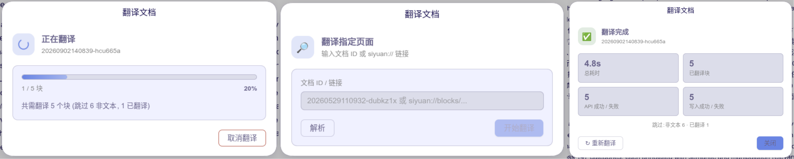
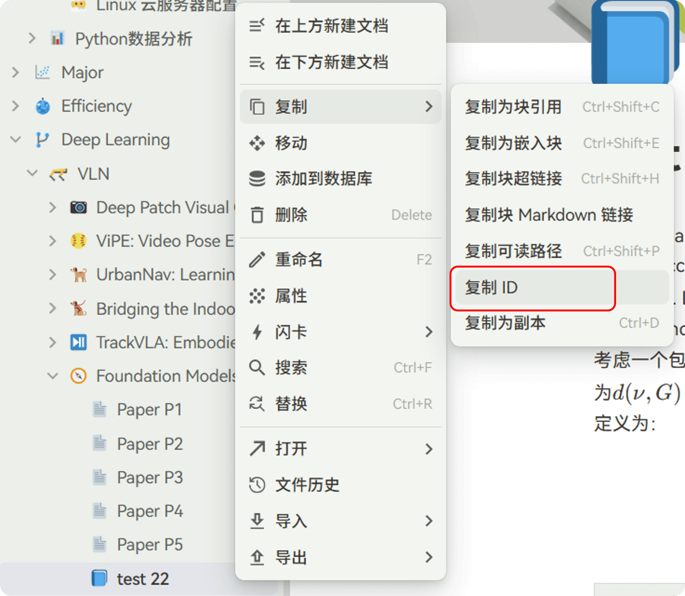

# Siyuan 文档翻译

思源笔记文档翻译插件,支持 **QWEN-MT(阿里百炼)** 与 **LLM(OpenAI 兼容)** 两套独立引擎,翻译结果直接写回笔记。

## 使用方式

### 图形界面

打开设置,选择翻译引擎并填入对应 API-KEY(必需)及其他信息(选填),配置检查通过后保存。

- 顶栏图标 → 直接打开「翻译工作台」浮动窗口(再次点击关闭)
- 快捷键 `⌥⇧⌘T`:翻译当前文档
- 编辑器、文档树右键菜单:翻译此文档
- 或复制页面 ID / `siyuan://blocks/...` 链接,在工作台「指定其他页面」中解析后翻译

工作台窗口特性:

- 可拖动、可置顶(置顶后点击外部或 `Esc` 不会关闭,可一边读文档一边停留)
- 位置与置顶状态自动记忆,`Esc` 关闭
- 深/浅色主题跟随思源外观设置实时切换
- 顶部页签在「翻译工作台 / 插件设置」之间切换

## 翻译引擎

- **QWEN-MT(DashScope)**:阿里百炼 OpenAI 兼容端点,支持术语干预、翻译记忆、领域提示。
- **LLM(OpenAI 兼容)**:任意标准 `/chat/completions` 端点,可自定义翻译 Prompt;模型名支持历史记录下拉。

两套引擎配置相互独立,在设置中切换,互不影响。

**网络出口**可选「通过思源内核访问」(默认,不受 CORS 限制)或「自动选择系统代理」(前端直连,跟随系统代理)。点击「取消翻译」立即停止:在途请求不再重试、排队块不再开始、未回写内容不写入。

## 翻译规则

- **标题**:保留级别标记,中文紧跟英文同行,如 `# 4.2. Training Strategies` → `# 4.2. Training Strategies 4.2. 培训策略`
- **正文**:保留英文原文,换行后附中文翻译(不分段)
- **行内公式**:`$...$` 标记在翻译前后通过占位符保护,确保中文行中公式可正常渲染
- **跳过内容**:独立公式块、HTML/表格、图片链接原样保留不翻译

### 写入模式

- **双语追加**:保留原文,译文追加其后(默认)
- **替换原文**:块内容替换为译文
- **新建译文文档**:汇总译文,在同笔记本新建 `<标题> (译文)` 文档

## 已翻译检测

对每个块判断是否已翻译:取 content 后 30% 文本,若中文字符占比 ≥ 60% 则跳过。含残留中文的段落会提取英文部分重新翻译;标题含任何中文则直接跳过(避免编号重复问题)。

## 统计

LLM 引擎解析 OpenAI 兼容响应的 `usage` 统计 token 用量;端点不返回 usage 或缓存字段则对应项不计入(命中率显示 `—`)。

- **LLM 累计统计**(设置面板):跨会话持久化的累计翻译次数、累计缓存命中率、累计输入/输出 Token,支持「清零」
- **本次 Token 统计**(翻译完成页):本次运行的翻译次数、缓存命中率、输入/输出 Token

Token 以 M(百万)为单位显示;缓存命中率 = 缓存命中 Token ÷ 输入 Token。失败调用会在完成页展示 HTTP 状态码明细。

## 配置详情

| 字段 | 说明 | 默认值 |
|------|------|--------|
| engine | 翻译引擎(`qwen_mt` / `llm`) | qwen_mt |
| api_key | 阿里百炼 API Key | — |
| model_name | QWEN-MT 翻译模型 | qwen-mt-plus |
| api_url | DashScope OpenAI 兼容端点 | `https://dashscope.aliyuncs.com/compatible-mode/v1/chat/completions` |
| source_lang | 源语言 | English |
| target_lang | 目标语言 | Chinese |
| terms | 术语干预(原文→译文) | — |
| tm_list | 翻译记忆(参考例句) | — |
| domains | 领域提示 | — |
| llm_api_key | LLM 引擎 API Key | — |
| llm_base_url | LLM 引擎 Base URL(自动补全 `/chat/completions`) | `https://api.vveai.com/v1` |
| llm_model_name | LLM 模型名 | deepseek-v4.1-flash |
| llm_prompt | LLM 翻译 Prompt(系统提示词) | 默认翻译指令 |
| concurrency | QWEN-MT 并发数 | 4 |
| llm_concurrency | LLM 并发数 | 4 |
| max_retries | 失败重试次数 | 3 |
| backoff_base | 退避基数(秒),指数增长上限 5s | 1 |
| write_mode | 写入模式(`append` / `replace` / `new_doc`) | append |
